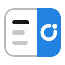

<h1 align="center">Cofun</h1>

  AI side panels for Chrome, each one at home beside a different kind of page. 
  Ask in plain words; the panel reads the page you're on, does the work, and shows you every change.

  
  

## The extensions

Each extension is installed on its own, from the Chrome Web Store, and has its own page here: what it can do, how to start, and what to watch out for.

| Extension | Works with | |
|---|---|---|
|  **[Notico](extensions/notico/README.md)** | Notion | Reads and edits your Notion pages with you: pages, databases, comments, search. _Not published yet._ |

Confluco, for Confluence, is next.

## One account for all of them

- **The same account everywhere.** Every extension signs in on the same Cofun sign-in page (Google is supported), so it is one account wherever you use it.
- **One balance of credits.** Asking the AI costs credits, and every account gets free credits each week. They are one balance across the extensions: what you use in one is gone from the others.
- **One server, which never talks to the sites you work on.** The extensions share one server. It checks who you are, keeps your credits, and passes the conversation to the AI model, which runs on Cloudflare Workers AI. It never talks to Notion or any other site: the work on your pages happens in your browser, in your own tab.

**Privacy.** The server never keeps what you asked or what the AI answered. [PRIVACY.md](PRIVACY.md) says what the server and sign-in do with your data, for every extension; each extension's own privacy page says what it reads in your browser and which hosts it talks to ([Notico's](extensions/notico/PRIVACY.md)).

## For developers

This repository holds every extension, one folder each in [`extensions/`](extensions), and the backend they share in [`worker/`](worker): a Cloudflare Worker for sign-in, the model, and credits.

- [Architecture](docs/architecture.md): how it is built, the technical choices and why, the sign-in flow, and the code layout.
- [Development](docs/development.md): build and load an extension, run the checks, and deploy your own worker.
- [AGENTS.md](AGENTS.md): the issue → PR → review → merge workflow and coding rules.
- [BDD](docs/bdd.md) and [use cases](docs/use-cases): the product behavior contract, per extension, and how it is tested.

## License

Copyright 2026 Cofun Labs. The code is licensed under the [Apache License 2.0](LICENSE). It grants no rights to the Cofun names and logos, or those of its extensions, as trademarks.

The extensions are independent open-source projects, not made or endorsed by the makers of the services they work with.
